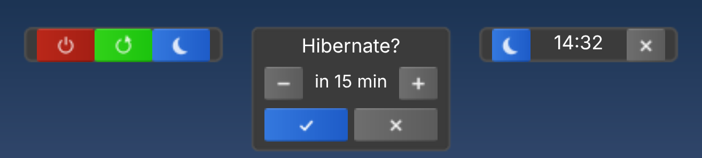

# Shutdown · Restart · Hibernate

A small Windows desktop gadget with three buttons: **shut down**, **restart** and **hibernate**. Every action asks for confirmation first, and you can delay it, from 1 minute up to 6 hours.



## Features

- **Three buttons in one bar:** shut down, restart and hibernate
- **Confirmation:** clicking a button expands the gadget and asks before anything happens. The prompt closes itself after 15 seconds without interaction.
- **Optional delay:** set it with **−** / **+** or the mouse wheel. The steps are *now*, 1, 5, 10, 15, 20, 30 and 45 min, then 1, 1.5, 2, 3, 4 and 6 h. The default is *now*, so a plain click on ✓ acts immediately.
- **Countdown:** with a delay, the gadget collapses back into a bar that shows the action, the remaining time and a cancel button. Hover over the icon to see the exact time. The countdown turns red during the last minute.
- **Laptop-safe:** if the computer goes to sleep or hibernates during a countdown and wakes up after the deadline, the action is skipped instead of firing right away.

## Requirements

- **Windows 7 / Vista** with the built-in Windows Sidebar, or
- **Windows 8, 10 or 11** with [8GadgetPack](https://8gadgetpack.net/), which brings back gadget support and includes 7 Sidebar
- To use **Hibernate**, hibernation must be enabled. If it isn't, run `powercfg /hibernate on` in an administrator command prompt.

## Installation

1. Download `ShutdownRestartHibernate.gadget` from [Releases](../../releases).
2. Double-click it and confirm the installation.
3. Drag the gadget from the gadget gallery onto your sidebar or desktop.

If you are updating an older version, remove the old one from the sidebar first.

## What the buttons run

| Button    | Command                    | Note                                       |
|-----------|----------------------------|--------------------------------------------|
| Shut down | `shutdown -p`              | turns the computer off immediately         |
| Restart   | `shutdown -r -f -t 01`     | forces running applications to close       |
| Hibernate | `shutdown /h`              | requires hibernation to be enabled         |

## Customization

All settings are at the top of `gadget/index.html`:

```js
var STEPS = [0, 1, 5, 10, 15, 20, 30, 45, 60, 90, 120, 180, 240, 360]; // delays in minutes
var ASK_TIMEOUT = 15000;   // ms before an untouched prompt closes
var SLEEP_GRACE = 30000;   // ms of "oversleeping" after which the action is skipped
```

The commands and texts are defined in the `ACTIONS` object in the same file.

## Building the `.gadget` file

A `.gadget` file is just a ZIP archive. Zip the **contents** of the `gadget` folder (not the folder itself), so that `gadget.xml` sits at the root of the archive. Then rename the archive to `.gadget`.

```powershell
Compress-Archive -Path gadget\* -DestinationPath ShutdownRestartHibernate.zip
Rename-Item ShutdownRestartHibernate.zip ShutdownRestartHibernate.gadget
```

While developing, you can skip zipping: copy the folder to
`%LOCALAPPDATA%\Microsoft\Windows Sidebar\Gadgets\ShutdownRestartHibernate.gadget\`
and re-add the gadget after every change.

## Technical notes

- Gadgets run in the old Internet Explorer engine (MSHTML), so the code is plain ES3 JavaScript with no frameworks and no modern CSS.
- The countdown runs inside the gadget, not as a Windows `shutdown /t` timer. Closing the gadget or the sidebar cancels it.
- The gadget changes its own height when the prompt expands. If your sidebar host doesn't resize gadgets on the fly, please open an issue.

## Credits

- Based on the **ShutdownRestart** gadget by **Midnight Mick** (2008)
- Hibernate button, confirmation, delay and countdown, plus redrawn buttons: **ZuNy** (2026)
